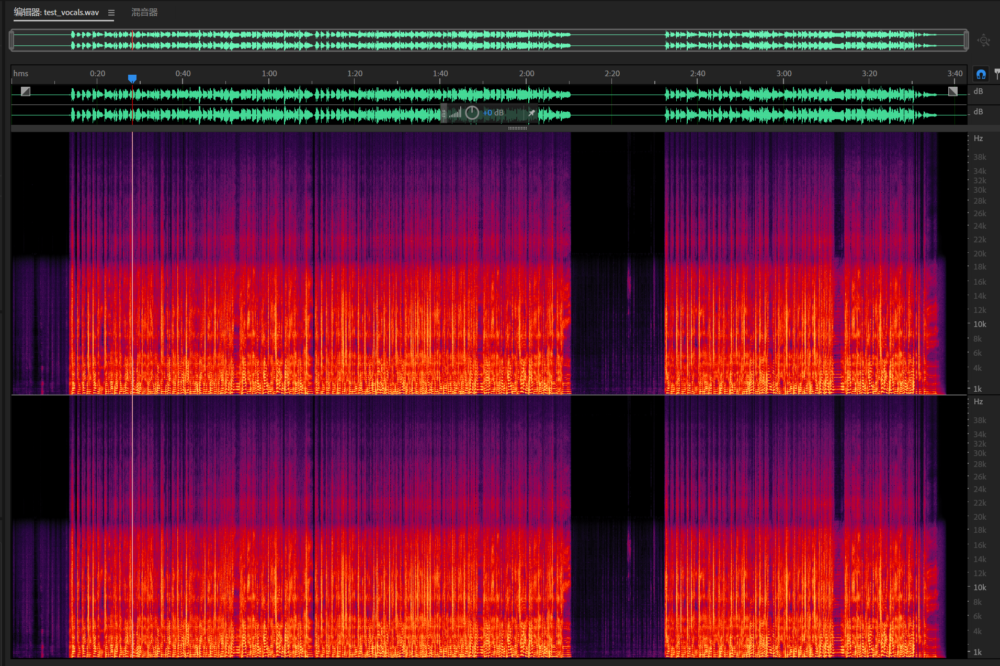
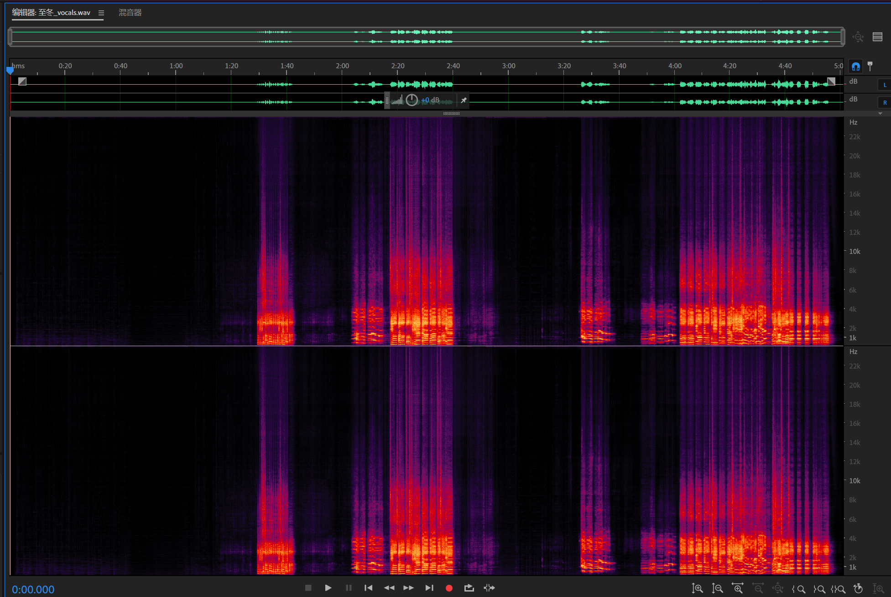

<h1 align="center">Musicgazer</h1>
<p align="center"><sub>望乐者</sub></p>
<div align="center">

[English](../README.md) | 简体中文<br>

</div>

## 简介

Musicgazer是 [MSST-WebUI](https://github.com/SUC-DriverOld/MSST-WebUI) 的一个改进，新增了高解析度音频分离功能，即无论使用什么采样率的分离模型都能按原音频采样率输出（低于模型采样率的除外）。MSST-WebUI是 [Music-Source-Separation-Training (MSST)](https://github.com/ZFTurbo/Music-Source-Separation-Training) 的 WebUI 应用，支持各种音频模型的训练和推理、自定义预设处理流程、模型安装、高级合奏模式，以及 [SOME](https://github.com/openvpi/SOME/) 集成。

> [!IMPORTANT]
> [MSST-WebUI](https://github.com/SUC-DriverOld/MSST-WebUI) 即将停止维护，建议查阅原仓库了解最新状态及迁移方案（如 [pymss](https://github.com/pymss-project/pymss)），或移植到 UVR5 等其他宿主。本项目仅维护高解析度音频分离功能。

## 重要特性

- **无损变频策略**：以最常见的 44.1 kHz 模型分离 48 khz 音频为例，该策略会将频率线性压缩到模型频带，以略微低于原来音高的频率输入模型并输出分轨，再将分轨恢复原速。
- **频带分离**：在约 20 kHz 处分割音频，低频段送入模型正常分离，高频段使用 20khz 左右的分轨产生的掩码直接分离，本质上是由低频段的分离情况猜测高频段情况，与真正使用Hi-Res训练的模型还是有区别，但可以确保频谱来自原始音频，不存在生成式恢复手段。
- **模型无关**：适用于所有 MSST 架构（BS-RoFormer、Mel-Band RoFormer、MDX23C、HTDemucs、SCNet、Bandit、Apollo、Mamba2 等），策略仅依赖 `(audio) → {stem: audio}` 接口。
- **策略自动选择** — `orig_sr / 44100 ≤ 1.15` 时走 varispeed，否则走 band-split，也可手动指定。

完整技术细节见 [docs/enhance_demux.md](enhance_demux.md)。

## 快速开始

1. 按照下方[从源码运行](#从源码运行)安装 WebUI。
2. 通过「安装模型」页面下载模型，或将 `.ckpt` 文件手动放入 `pretrain/` 目录。
3. 上传 48/96/192 kHz 音频文件，控制台将显示：
   ```
   Hi-res separation enabled | orig_sr: 96000 Hz → model_sr: 44100 Hz | strategy: band_split
   Separation complete: your_audio.flac → output_sr: 96000 Hz
   ```
4. 观察输出文件已保持原始采样率。

<div align="center">
    
    
</div>

## 使用方式

- **Windows**：从 [Releases](https://github.com/SUC-DriverOld/MSST-WebUI/releases) 下载安装程序，或克隆仓库从源码运行。
- **Linux/macOS**：克隆仓库从源码运行。
- **Google Colab**：[点击此处](https://colab.research.google.com/github/SUC-DriverOld/MSST-WebUI/blob/main/webUI_for_colab.ipynb) 在 Colab 上运行。

### 下载链接

安装程序、模型及镜像下载渠道，请参见上游 [MSST-WebUI](https://github.com/SUC-DriverOld/MSST-WebUI) 仓库。

### 文档

详细的飞书中文教程见 [此处](https://r1kc63iz15l.feishu.cn/wiki/JSp3wk7zuinvIXkIqSUcCXY1nKc)。更多文档见 `docs/` 文件夹。也可参考 [deton24](https://github.com/deton24) 的 [Instrumental and vocal & stems separation & mastering guide](https://docs.google.com/document/d/17fjNvJzj8ZGSer7c7OFe_CNfUKbAxEh_OBv94ZdRG5c)。

## 从源码运行

- 克隆仓库。

  ```bash
  git clone https://github.com/LDDROG/Musicgazer_HiResDemux.git
  cd Musicgazer_HiResDemux
  ```

- 创建 Python 环境并安装依赖，推荐 Python 3.10。

  ```bash
  conda create -n msst python=3.10 -y
  conda activate msst
  pip install torch torchvision torchaudio --index-url https://download.pytorch.org/whl/cu121
  pip install -r requirements.txt --only-binary=samplerate
  ```

- 修复 librosa 兼容性问题：打开 `site-packages/librosa/util/utils.py` 第 2185 行，将 `np.dtype(complex): np.dtype(np.float).type,` 改为 `np.dtype(complex): np.dtype(float).type,`。或使用以下命令：

  ```bash
  pip uninstall librosa -y
  pip install tools/webUI_for_clouds/librosa-0.9.2-py3-none-any.whl
  ```

- 启动 WebUI：

  ```bash
  python webUI.py
  ```

- 高级启动参数或云端部署见 [docs/webui.md](webui.md)。

- 使用 `swin_upernet` 时若遇到 `ValueError: Make sure that the channel dimension of the pixel values match with the one set in the configuration`，参考 [此 issue](https://github.com/SUC-DriverOld/MSST-WebUI/issues/24)。

## CLI 与 Python API

详见 [docs/inference.md](inference.md)。

### 集成示例

`enhance_demux` 模块设计为可嵌入任何兼容 MSST 的推理管道：

```python
import librosa
from enhance_demux import separate_hires

mix, orig_sr = librosa.load("audio_96k.wav", sr=None, mono=False)

# model, config, device, model_type 由你的管线设置
waveforms = separate_hires(
    mix, model, config, device, model_type,
    orig_sr=orig_sr,    # 例如 96000
    target_sr=44100,
)
# waveforms["vocals"] → (channels, time)，采样率为 orig_sr
```

### 移植到 UVR5

UVR5 遵循相同的 `加载 → 分离 → 保存` 模式。添加原生采样率支持：

1. 将 `enhance_demux/` 复制到 UVR5 的 `gui/` 目录。
2. 以原生采样率加载音频：
   ```python
   mix, sr = librosa.load(path, sr=None, mono=False)
   ```
3. 在模型调用后添加高解析度分支：
   ```python
   if sr > 44100:
       from enhance_demux import separate_hires
       results = separate_hires(mix, model, config, device, model_type,
                                orig_sr=sr)
   else:
       results = demix(config, model, mix, device, model_type=model_type)
   ```
4. 以 `sr` 而非硬编码的 `44100` 写入输出文件。

策略与模型架构无关——兼容 MDX-Net、VR Arch、Demucs 等任何遵循 `(audio) → {stem: audio}` 接口的架构。

## 训练与验证

详见 [docs/training.md](training.md)。

## 参考

### 上游项目

- [MSST-WebUI](https://github.com/SUC-DriverOld/MSST-WebUI) — 本项目 fork 来源
- [Music-Source-Separation-Training](https://github.com/ZFTurbo/Music-Source-Separation-Training) — ZFTurbo 的 MSST 训练框架
- [Ultimate Vocal Remover](https://github.com/Anjok07/ultimatevocalremovergui) — VR 模型推理

### 工具与库

- [librosa](https://github.com/librosa/librosa) — 音频分析（STFT、重采样、滤波）
- [scipy](https://github.com/scipy/scipy) — 信号处理（零相位 Butterworth 滤波器）
- [PyQt-Fluent-Widgets](https://github.com/zhiyiYo/PyQt-Fluent-Widgets) — UI 组件
- [PySide6](https://doc.qt.io/qtforpython-6) — Qt for Python
- [Singing-Oriented MIDI Extractor (SOME)](https://github.com/openvpi/SOME/) — MIDI 提取工具

### 社区

- [deton24 的音频分离与母带处理指南](https://docs.google.com/document/d/17fjNvJzj8ZGSer7c7OFe_CNfUKbAxEh_OBv94ZdRG5c)
- [ComfyMSS](https://github.com/KitsuneX07/ComfyMSS) — ComfyUI 音乐源分离节点
- [python-audio-separator](https://github.com/nomadkaraoke/python-audio-separator) — Python 音频分离库

### 感谢所有贡献者

<a href="https://github.com/SUC-DriverOld/MSST-WebUI/graphs/contributors" target="_blank">
  
</a>

### 感谢所有模型提供者

<table>
  <tr>
    <td style="text-align: center;"></td>
    <td style="text-align: center;"></td>
    <td style="text-align: center;"></td>
    <td style="text-align: center;"></td>
    <td style="text-align: center;"></td>
    <td style="text-align: center;"></td>
  </tr>
  <tr>
    <td style="text-align: center;"><a href="https://github.com/anvuew">anvuew</a></td>
    <td style="text-align: center;"><a href="https://github.com/aufr33">aufr33</a></td>
    <td style="text-align: center;"><a href="https://github.com/deton24">deton24</a></td>
    <td style="text-align: center;"><a href="https://github.com/jarredou">jarredou</a></td>
    <td style="text-align: center;"><a href="https://github.com/pcunwa">pcunwa</a></td>
    <td style="text-align: center;"><a href="https://github.com/SUC-DriverOld">Sucial</a></td>
  </tr>
  <tr>
    <td style="text-align: center;"></td>
    <td style="text-align: center;"></td>
    <td style="text-align: center;"></td>
    <td style="text-align: center;"></td>
    <td style="text-align: center;"></td>
    <td></td>
  </tr>
  <tr>
    <td style="text-align: center;"><a href="https://github.com/Super-YH">Super-YH</a></td>
    <td style="text-align: center;"><a href="https://github.com/playdasegunda">viperx</a></td>
    <td style="text-align: center;"><a href="https://github.com/wesleyr36">wesleyr36</a></td>
    <td style="text-align: center;"><a href="https://github.com/yxlllc">yxlllc</a></td>
    <td style="text-align: center;"><a href="https://github.com/ZFTurbo">ZFturbo</a></td>
    <td></td>
  </tr>
</table>
